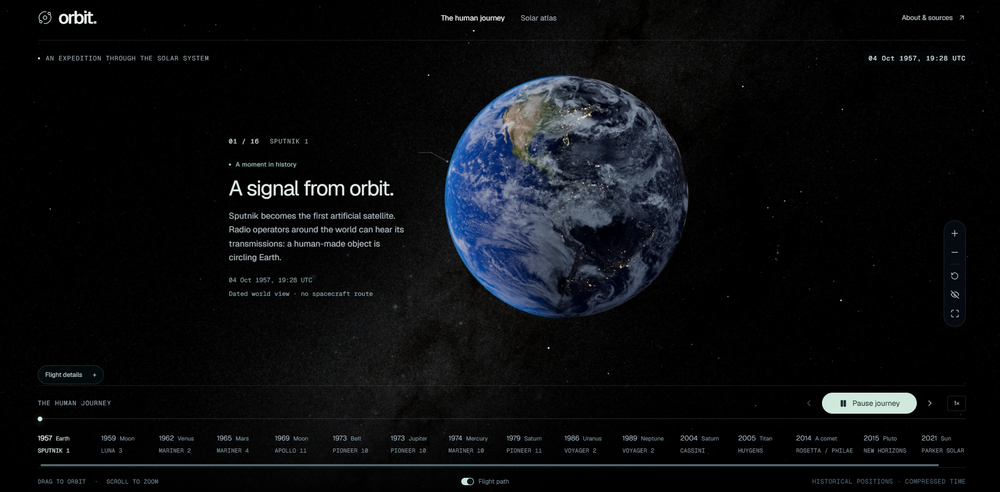
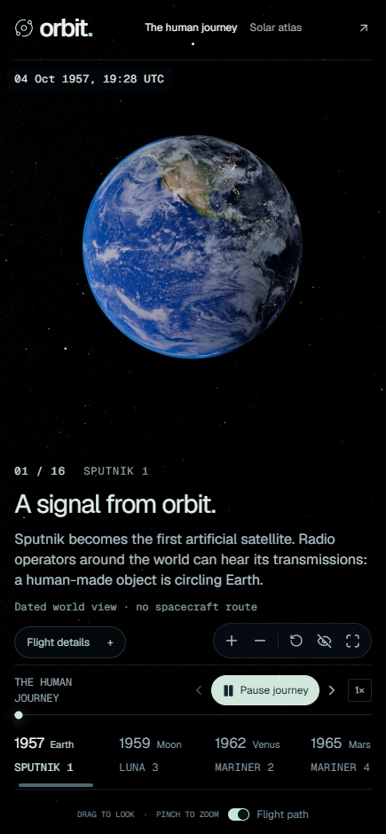

# ORBIT: A Solar System Odyssey

A 3D solar system in the browser that replays real spacecraft missions from 1957 to 2021, using position data from NASA JPL.

**Live: https://orbit.havlli.dev**

<p align="center">
  
  
</p>

Built with React 19, TypeScript, Three.js, Vinext (the Next.js API on Vite), Tailwind CSS 4 and Base UI. It ships as static files on Cloudflare.

## What it does

The Journey mode replays selected missions, including Cassini, Voyager and Parker, and closes in on what each one found at its encounters. Spacecraft and planets share one historical clock, so a flyby looks the way it happened. Where there is no validated trajectory, the app shows no route.

The Solar atlas is a separate illustrated view of the planets, moons, Ceres, Vesta and the asteroid and Kuiper belts. It has no date. The layout works on phones and desktop, with keyboard controls and a reduced-motion mode.

## Run it locally

You need Node.js 22.13 or newer.

```sh
npm ci
npm run dev
```

Open the URL it prints.

## Checks, CI and deploy

```sh
npm run typecheck
npm run lint
npm run test:missions    # ephemeris sampling, camera, scene and cadence checks
npm run build:static     # static export to dist/client/
npm run preview:static -- --port 3001    # serve the export locally
```

The npm scripts use POSIX environment variables, so on Windows run them in WSL or Git Bash.

GitHub Actions runs install, lint, type check, mission tests and the static build on every pull request and on pushes to `main`.

Production deploys through Cloudflare Workers Builds, which runs `npm ci && npm run typecheck && npm run lint && npm run test:missions && npm run build:static` and then uploads `dist/client/` with `npx wrangler deploy --config wrangler.static.jsonc`. A failing check stops the deploy. The deployment config contains only static assets, with no server script, runtime bindings or database.

## How it works

Python importers in `scripts/` turn JPL Horizons and NASA NAIF SPICE states into bundled JSON in `public/ephemeris/`. The browser fetches those files from the site rather than querying the source services. The sources and their limits are in [public/ephemeris/SOURCES.md](public/ephemeris/SOURCES.md).

Mission playback uses one continuous TDB clock and cubic Hermite interpolation, without extrapolation across missing coverage. Distances and physical body radii use one uniform scale. Coordinates are rebased near the spacecraft before GPU conversion to preserve precision. Camera movement and playback speed are editorial, spacecraft are enlarged, and surface maps and craft attitude remain illustrative.

Each chapter is labelled as a tracking reconstruction, an archival navigation solution, or no validated route. Missing and predicted routes are left out.

The pages are rendered at build time and served as static files, so there is no API or database to run.

Where to start reading: `app/ephemeris.ts` loads and interpolates the data, `app/mission-flight.ts` replays a mission, `app/mission-cinematography.ts` handles the camera, `app/solar-scene.tsx` is the Three.js scene and `app/page.tsx` is the interface. More detail is in [docs/DESIGN-NOTES.md](docs/DESIGN-NOTES.md).

## Credits and license

The code is MIT, see [LICENSE](LICENSE). Assets include Solar System Scope textures (CC BY 4.0), NASA spacecraft models, and NASA and USGS imagery. Trajectory data comes from NASA JPL. See the [texture and imagery credits](public/SOLAR-ASSETS.md), [Saturn credits](public/ATTRIBUTION.md), [model credits](public/models/README.md) and [sky credits](public/sky/SOURCES.md). Third-party assets keep their own licenses.
